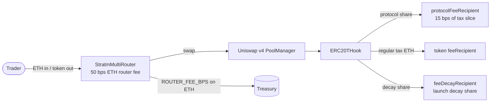

# strat-market-contracts

Verified Foundry sources for Strat Market token launches on [Robinhood Chain](https://robin.etherscan.io) (chain ID **4663**). This repository contains the ERC20T launch stack (token, factory, Uniswap v4 hook) and related routers used by [stratmarket.fun](https://stratmarket.fun).

## What this is

**Strat Market** is a token launchpad on Robinhood Chain. Creators can launch tokens through two paths on [stratmarket.fun/launch](https://stratmarket.fun/launch):

1. **Pons Bonding Curve** — bonding-curve style launch (contracts for that path live in the main application repository, not here).
2. **ERC20T + tax hook on Uniswap v4** — fixed-supply ERC20T clones with swap taxes enforced by a shared `ERC20THook`, pooled against native ETH on Uniswap v4.

**STRATM** is the platform token: an ERC20T launched via this stack, trading on Uniswap v4 with a **3% resting swap tax** (300 bps). The deployed STRATM proxy is an [EIP-1167](https://eips.ethereum.org/EIPS/eip-1167) minimal clone of the ERC20T implementation; ownership has been renounced on-chain.

### Tax decay (launch schedule)

When launch decay is enabled (as for STRATM), the swap tax starts at **9900 bps** (99%) and decreases by **100 bps every 10 seconds** until it reaches the token’s resting rate. For STRATM the resting rate is **300 bps** (3%), which takes **96 steps** (~**16 minutes**).

| Time after launch (approx.) | Tax (bps) | Tax (%) |
|----------------------------|-----------|---------|
| 0 s | 9900 | 99.00% |
| 10 s | 9800 | 98.00% |
| 1 min | 9300 | 93.00% |
| 5 min | 6900 | 69.00% |
| ~16 min | 300 | 3.00% (resting) |

Constants in source: `LAUNCH_TAX_BPS = 9900`, `TAX_DECAY_STEP_BPS = 100`, default `taxDecayIntervalSeconds = 10`, STRATM `TAX_BPS = 300` in `launch.sh` / `script/Launch.s.sol`.

### Fee routing

Swaps can interact with:

- **`StratmMultiRouter`** — multi-token router for factory ERC20T tokens; charges a **50 bps** ETH fee (`ROUTER_FEE_BPS`) to the treasury.
- **`ERC20THook`** — applies the token’s current `taxBps()` on swaps; includes a fixed **15 bps** of swap output for the shared protocol (`PROTOCOL_FEE_BPS`), with the remainder of the tax going to the token’s `feeRecipient` (and launch-decay routing to `feeDecayRecipient` where applicable).



## Verified contracts (Robinhood Chain)

| Contract | Address | Source in this repo | Explorer |
|----------|---------|---------------------|----------|
| STRATM (clone) | `0xABCC6e05718543faB52b16d7086D3FD32f0063B3` | Clone of ERC20T impl; launch via `script/Launch.s.sol` | [RobinScan](https://robin.etherscan.io/address/0xABCC6e05718543faB52b16d7086D3FD32f0063B3#code) |
| ERC20T implementation | `0xd6db8f4818306af19a9ed6e4c4595fd55df9b4aa` | `src/ERC20T/ERC20T.sol` | [RobinScan](https://robin.etherscan.io/address/0xd6db8f4818306af19a9ed6e4c4595fd55df9b4aa#code) |
| ERC20TFactory | `0x74C6654Eb785Bc7863DA21dFCa37cA450fBd540d` | `src/ERC20T/ERC20TFactory.sol` | [RobinScan](https://robin.etherscan.io/address/0x74C6654Eb785Bc7863DA21dFCa37cA450fBd540d#code) |
| ERC20THook | `0xf43C7cC459A9430093f06b081f672F27e103a544` | `src/ERC20T/ERC20THook.sol` | [RobinScan](https://robin.etherscan.io/address/0xf43C7cC459A9430093f06b081f672F27e103a544#code) |
| StratmMultiRouter | `0x0fA032e55f1E4a4c33542B961a662bf1059a0ec0` | `src/StratmMultiRouter.sol` | [RobinScan](https://robin.etherscan.io/address/0x0fA032e55f1E4a4c33542B961a662bf1059a0ec0#code) |
| StratmRenounceLauncher | `0x9Fdc15348457F0170cfA6c14551637e8c0b6B384` | Source in main app repo, not included | [RobinScan](https://robin.etherscan.io/address/0x9Fdc15348457F0170cfA6c14551637e8c0b6B384#code) |

STRATM on-chain notes (from RPC reads): `owner()` is `address(0)` (renounced). The clone bytecode embeds implementation `0xd6db8f4818306af19a9ed6e4c4595fd55df9b4aa` and hook `0xf43C7cC459A9430093f06b081f672F27e103a544`. A launch block of **90457925** is referenced in project materials; the full launch transaction hash is not present in this package’s scripts.

## Build

Requires [Foundry](https://book.getfoundry.sh/getting-started/installation).

```bash
forge build
```

Vendored dependencies live under `lib/` (not git submodules). Versions are noted in `lib-versions.txt`.

### Compiler settings (RobinScan verification)

These match `foundry.toml` and the verified deployment settings:

| Setting | Value |
|---------|--------|
| Solidity | **0.8.26** |
| EVM | **cancun** |
| Optimizer | **on**, **1** run |
| `via_ir` | **true** |
| `bytecode_hash` | **none** |
| `cbor_metadata` | **false** |

## Verify it yourself

1. **Build** — `forge build` and confirm artifacts under `out/`.
2. **Compare runtime bytecode** — use **deployed** bytecode (not creation bytecode):

   ```bash
   RPC=https://rpc.mainnet.chain.robinhood.com
   IMPL=0xd6db8f4818306af19a9ed6e4c4595fd55df9b4aa
   LOCAL=$(jq -r '.deployedBytecode.object' out/ERC20T.sol/ERC20T.json)
   cast code $IMPL --rpc-url $RPC | cmp - <(echo "0x$LOCAL")
   ```

   - **ERC20T implementation** — local `deployedBytecode` should match `cast code` at the implementation address exactly.
   - **ERC20TFactory / ERC20THook** — local artifacts zero out [immutable](https://docs.soliditylang.org/en/latest/contracts.html#immutable-variables) slots in `deployedBytecode`; on-chain code fills those slots at deploy time (e.g. factory `implementation`, hook `poolManager` / owner / protocol recipient). Compare logic by verifying immutables on-chain, e.g.:

     ```bash
     cast call 0x74C6654Eb785Bc7863DA21dFCa37cA450fBd540d "implementation()(address)" --rpc-url $RPC
     cast call 0xf43C7cC459A9430093f06b081f672F27e103a544 "poolManager()(address)" --rpc-url $RPC
     ```

   - **STRATM clone** — runtime code is a minimal proxy plus clone immutables, not the full ERC20T implementation bytecode.

3. **Explorer** — open the **Contract** tab on [RobinScan](https://robin.etherscan.io) for each address and use “Read Contract” / verified source.

## Repository layout

```
├── foundry.toml
├── launch.sh
├── lib/                 # vendored forge-std, solady, v4-core, v4-periphery
├── lib-versions.txt
├── script/              # Deploy.s.sol, Launch.s.sol, HookMiner.sol
├── src/
│   ├── ERC20T/          # ERC20T, ERC20TFactory, ERC20THook
│   ├── StratmMultiRouter.sol
│   └── StratmSwapRouter.sol
└── test/
```

## Credit and licensing

ERC20T is a fork adapted for Robinhood Chain. Original SPDX license headers in source files are preserved.

- **First-party** contracts in `src/`, `script/`, and `test/` are **MIT** (see [LICENSE](LICENSE)).
- **Vendored** libraries under `lib/` retain their own licenses (mostly MIT; Uniswap `v4-core` includes **BUSL-1.1** files such as `lib/v4-core/src/libraries/Pool.sol`). `forge-std` is **MIT OR Apache-2.0**. Do not treat the root `LICENSE` as applying to all of `lib/`.

## Links

- Website: https://stratmarket.fun  
- Docs: https://stratmarket.fun/docs  
- Whitepaper: https://stratmarket.fun/whitepaper  
- X: https://x.com/rhStratMarket  
- Explorer: https://robin.etherscan.io  

## Risks

These contracts are **not** described as audited. This repository is for transparency and verification only; it is **not** investment advice. Use at your own risk.
